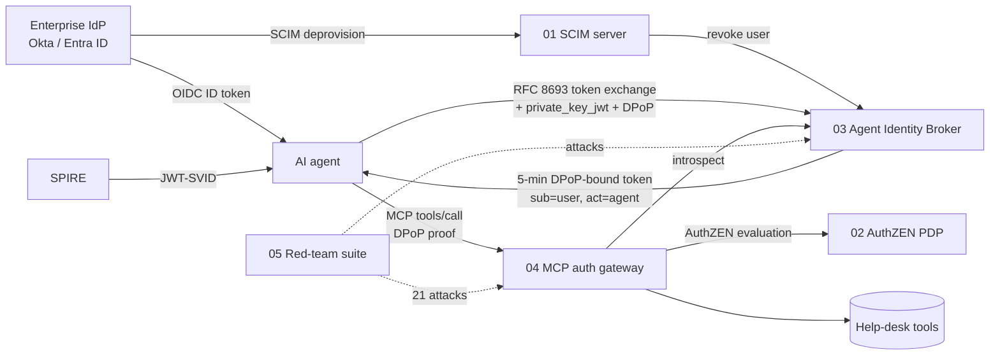

# Agentic AI Identity & Security

[](https://github.com/ppaulette/Agentic-AI-Identity-Security/actions/workflows/ci.yml)


Working reference implementations of identity, delegation and authorization for AI agents
that call tools on behalf of people.

When an agent reads a ticket, issues a refund or exports data, four questions must have
answers at the moment of the call:

1. **Which agent is this, and can it prove it?**
2. **Which user is it acting for, and did that user's access allow this?**
3. **Is this specific tool call allowed right now, given the risk?**
4. **When the user leaves or the agent is compromised, does access stop immediately?**

This repo answers them with standards (OAuth 2.0 Token Exchange, DPoP, SCIM, OpenID AuthZEN,
MCP authorization) and proves it with a 21-attack red-team suite that runs in CI.



## Projects

| # | Project | What it shows | Standards |
|---|---|---|---|
| 01 | [SCIM provisioning](projects/01-scim-provisioning) | Deactivating a user in the IdP immediately cuts off every agent acting for them | SCIM 2.0 (RFC 7643, 7644) |
| 02 | [AuthZEN PDP](projects/02-authzen-pdp) | Deny-by-default policy per tool call: scopes, agent-forbidden tools, step-up approval, amount limits, device posture | OpenID AuthZEN 1.0 |
| 03 | [Agent Identity Broker](projects/03-agent-identity-broker) | Agents get short-lived, down-scoped, sender-constrained tokens to act for a user; kill switch per agent; CLI | RFC 8693, 7523, 9449, 8707, 7662, 8414, 9068 |
| 04 | [MCP auth gateway](projects/04-mcp-auth-gateway) | An MCP server as an OAuth resource server: discovery, DPoP, introspection, per-call authorization, human approval | MCP authorization, RFC 9728, 9449, 6750 |
| 05 | [Agent red team](projects/05-agent-redteam) | 21 attacks (token theft, replay, forgery, impersonation, workload-identity spoofing, prompt injection, unsafe delegation, orphaned access), each tied to the control that stops it | OWASP LLM Top 10, OWASP Agentic AI threats |
| 06 | [Workload identity](projects/06-workload-identity) *(in progress)* | Agents authenticate with SPIFFE JWT-SVIDs from SPIRE instead of stored keys | SPIFFE, JWT-SVID |
| — | [idkit](libs/idkit) | Shared strict JOSE helpers: pinned ES256, JWK thumbprints, DPoP proofs, replay cache, audit log | RFC 7515, 7517, 7519, 7638 |

## Run it

Requires [uv](https://docs.astral.sh/uv/) and Python 3.12.

```bash
uv sync
uv run python scripts/demo.py      # narrated end-to-end walkthrough
uv run pytest                      # 75 tests
uv run python -m redteam           # writes reports/redteam-report.md
```

The demo provisions a user, delegates to a help-desk agent, lets the agent fall for a prompt
injection in a ticket, steals its token, asks for a refund with and without human approval,
and deprovisions the user mid-session. Every step is blocked or allowed for a stated reason
and lands in the audit log. See [the latest red-team report](reports/redteam-report.md).

## Design decisions

- **The user is the subject; the agent is the actor.** Tokens carry `sub=user` and
  `act.sub=agent` (RFC 8693), so every downstream decision and log line knows both.
- **Least privilege by intersection.** Granted scope = requested ∩ agent registration ∩
  user's roles. An agent can never do more than the person it acts for.
- **Tokens are useless when stolen.** Every access token is bound to the agent's DPoP key
  (`cnf.jkt`), lives 5 minutes, and is audience-restricted to one resource server.
- **Revocation is immediate.** SCIM deprovisioning and the agent kill switch are enforced
  through introspection on every call, not only at token expiry.
- **Authorization is per call, not per session.** The gateway asks the PDP before each tool
  runs, so policy can use the tool's risk, the arguments and human approval.
- **High-risk actions need a human.** Approvals are bound to one user and one tool, and are
  single-use.

More in [docs/architecture.md](docs/architecture.md) and the
[threat model](docs/threat-model.md).

## Scope and limits

This is a reference implementation meant to be read, run and attacked. State is in memory,
service-to-service secrets are static, and the IdP is a mock that issues OIDC ID tokens. The
[architecture notes](docs/architecture.md#from-lab-to-production) list what changes for
production.

## Roadmap

- [x] **06a Workload identity in the broker:** agents authenticate with SPIFFE JWT-SVIDs (tested, 3 new attacks)
- [ ] **06b SPIRE on Kubernetes (kind):** live SVIDs from a real SPIRE server; mTLS between services; SPIFFE → cloud federation
- [ ] **07 Egress control:** Envoy in front of agent containers, network reach following identity
- [ ] **08 Device trust:** agent keys held in the Secure Enclave / TPM; posture as a PDP input
- [ ] **09 Real IdP:** Keycloak or Okta developer tenant in place of the mock IdP
- [ ] **10 Policy engines:** the same policy in Cedar and OPA/Rego behind the AuthZEN API

## License

MIT
