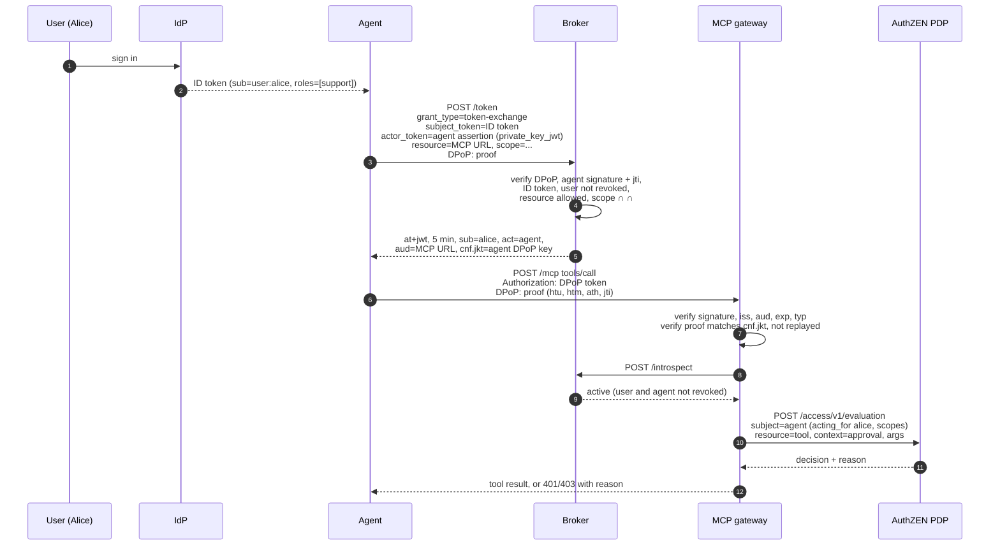
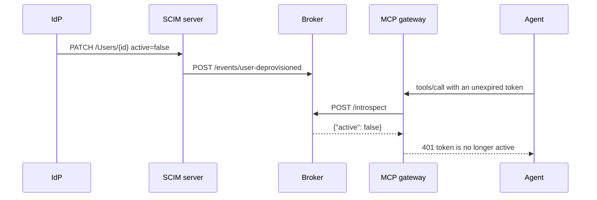

# Architecture

## Components

| Component | Role in OAuth terms | Trusts |
|---|---|---|
| Enterprise IdP (mocked) | OpenID Provider | — |
| SCIM server | SCIM service provider | IdP's provisioning bearer token |
| Agent Identity Broker | Authorization server (token exchange only) | IdP JWKS; each agent's registered public key |
| MCP auth gateway | Resource server + policy enforcement point (PEP) | Broker JWKS and introspection; PDP decisions |
| AuthZEN PDP | Policy decision point | Its policy file |
| AI agent | OAuth client acting for a user | Broker |

## Delegated tool call



## Revocation



The same path handles a compromised agent: `POST /events/agent-disabled` makes every token
for that agent inactive and stops new ones being issued.

## Token contents

```json
{
  "iss": "https://broker.example.test",
  "sub": "user:alice",
  "act": { "sub": "agent:helpdesk-bot" },
  "client_id": "agent:helpdesk-bot",
  "aud": "https://mcp.tickets.example/mcp",
  "scope": "tickets.read tickets.write",
  "cnf": { "jkt": "<RFC 7638 thumbprint of the agent's DPoP key>" },
  "iat": 1795413641, "nbf": 1795413641, "exp": 1795413941,
  "jti": "..."
}
```

Header: `{"alg": "ES256", "typ": "at+jwt", "kid": "broker-1"}`.

## Why these choices

**Token exchange instead of giving the agent the user's token.** The user's token would let
the agent do anything the user can, anywhere, for as long as it lives. Exchange produces a
new token that is narrower (scope ∩), shorter (5 minutes), bound to one resource, and records
the agent in `act`.

**DPoP instead of bearer tokens.** Agents log, cache and pass context around, and prompt
injection can make them echo secrets. A DPoP-bound token is worthless without the private
key, which never leaves the agent process. (mTLS-bound tokens, RFC 8705, are the alternative
when agents run as SPIFFE workloads; see the roadmap.)

**Introspection on every call.** Local JWT validation is fast but cannot see revocation.
Introspection costs one call to the broker and makes deprovisioning and the agent kill switch
take effect at once. At scale this becomes a short-TTL cache or a pushed revocation list
(for example via the Shared Signals Framework / CAEP).

**A separate PDP.** Keeping policy out of the gateway means the same decision point can
serve other gateways and tools, and the policy can be reviewed and tested on its own. AuthZEN
standardises the request shape so the PDP can be swapped for Cedar, OPA, OpenFGA or a vendor
product.

**Approvals bound to user and tool, used once.** A generic "approved" flag can be replayed
by an agent for a different user or a larger amount. Binding and single use close that.

## From lab to production

| Lab | Production |
|---|---|
| Mock IdP | Okta / Entra ID; validate via OIDC discovery and rotating JWKS |
| Agent keys registered by hand | SPIFFE SVIDs or cloud workload identity; keys in HSM, TPM or Secure Enclave |
| In-memory state, replay caches | Redis or a database shared across replicas |
| Static shared secrets between services | mTLS (SPIFFE) or private_key_jwt for introspection and events |
| Introspection on every call | Short-TTL cache plus pushed revocation events (SSF/CAEP) |
| Approvals via an API call | Approval UI or chat workflow with the approver's own authentication |
| JSON policy | Cedar or Rego, versioned and tested in CI |
| Audit to a list/JSONL | SIEM pipeline with user, agent, tool, decision and reason as fields |
